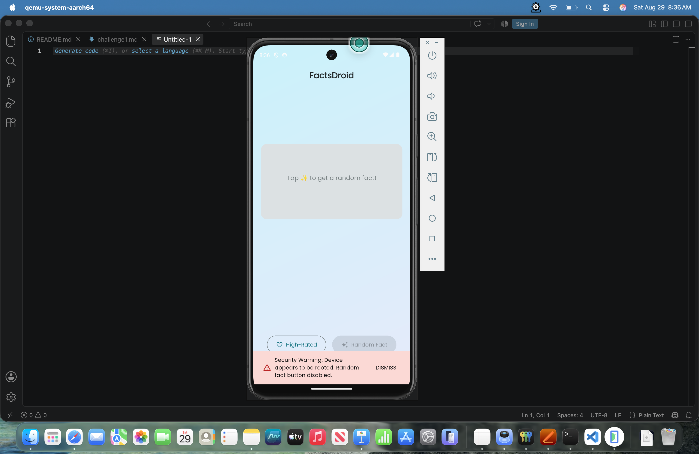
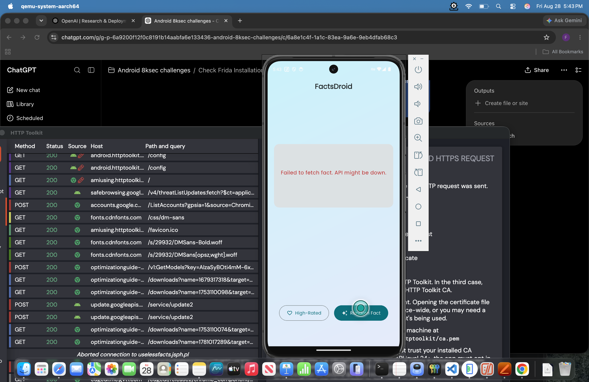
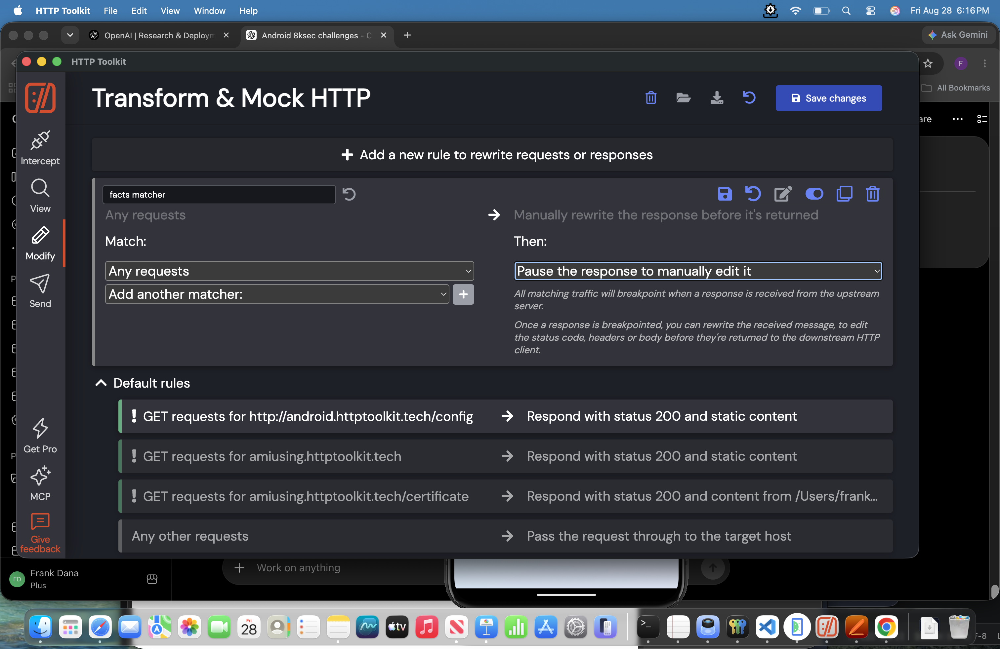
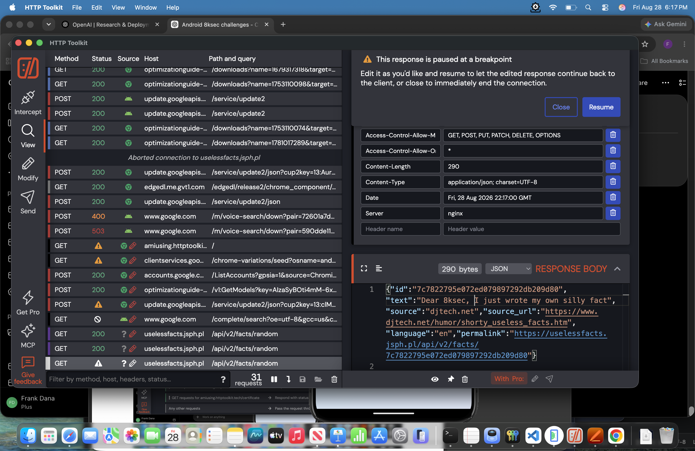
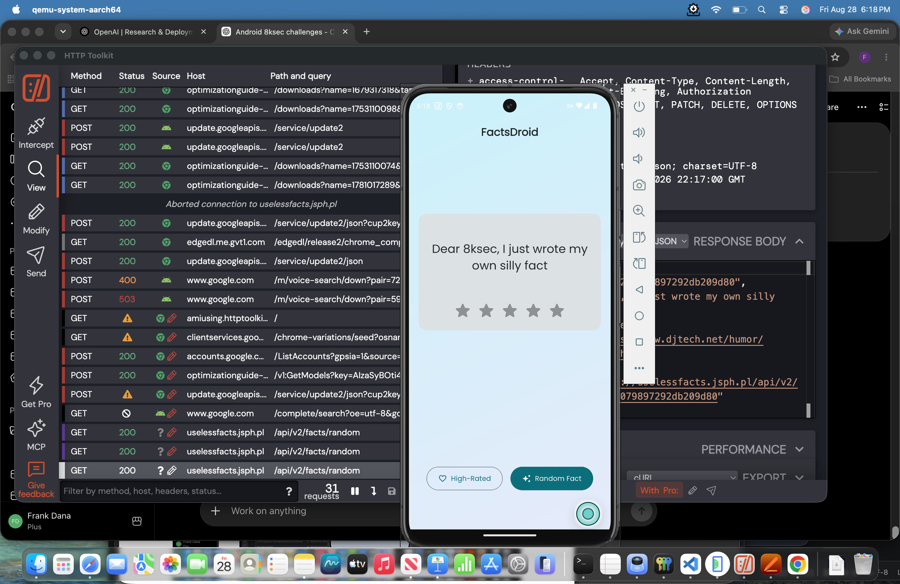

# FactsDroid Challenge 1

## Overview

FactsDroid is a mobile application that retrieves and displays random facts from an online API. Users can rate the facts they receive and save their favorites in an encrypted local database.

## Objective

The goal of this challenge is to perform a machine-in-the-middle (MITM) attack and manipulate the facts displayed to the user. This requires intercepting the network traffic between FactsDroid and its backend server, then modifying the API responses without statically patching the provided APK.

## Exploitation Process

Install the application on a rooted emulator - Pixel 8 API 34 device.

```bash
adb install -r -g -t FactsDroid.apk
```

### Random Fact button disabled

On app start up, FactsDroid root-detection mechanism sees that the emulator is rooted and disables the "Random Fact" button.

<figure style="margin: 0; width: 800px;">
  
  <figcaption style="text-align: center;">
    <em>Figure 1: FactsDroid Random Fact button disabled.</em>
  </figcaption>
</figure>

<div style="page-break-after: always; break-after: page;"></div>

#### Install Frida Server

In order to use tools like Objection or Medusa, Frida server needs to be running on the device.

Install Frida Server: 

```bash
adb push frida-server-17.17.0-android-arm64 /data/local/tmp/frida-server
adb shell
cd /data/local/tmp
su
chmod +x /data/local/tmp/frida-server
```

Start Frida Server:

```bash
cd /data/local/tmp
su
./frida-server
```

#### Install Objection

To disable the root checker, Objection was attempted.

Install Objection on the host machine:

```bash
pipx install objection
```

Spawn FactsDroid with Objection:

```bash
objection -n com.eightksec.factsdroid start
```

In the Objection CLI:
```bash
android root disable
```

Note: This did not defeat the FactDroid app root checker.

- Objection’s `android root disable` bypassed common `su` file checks.
- The application remained restricted, indicating additional root-detection logic.
- Next step: use Medusa modules.

<div style="page-break-after: always; break-after: page;"></div>

#### Install Medusa

Install:

```bash
git clone https://github.com/Ch0pin/medusa.git
cd medusa

python3 -m venv .venv
source .venv/bin/activate

python -m pip install --upgrade pip
python -m pip install -r requirements.txt
```

Run:

```bash
python medusa.py
```

Disable root checker:

```bash
search root
use root_detection/universal_root_detection_bypass
show mods
compile
run -f com.eightksec.factsdroid
```

Success. The root checker is bypassed and the "Random Fact" button is now enabled.

### Unable to Communicate

Clicking the "Random Fact" button produced the next error. It was unable to communicate with the backend API.

HTTP Toolkit was installed but no traffic was captured from the FactsDroid app.

```bash
brew install --cask http-toolkit
```

<figure style="margin: 0; width: 800px;">
  
  <figcaption style="text-align: center;">
    <em>Figure 2: Generic API communication error displayed.</em>
  </figcaption>
</figure>

#### Logcat

Next, Logcat was used to analyze any app logs:

```bash
adb logcat -c
adb logcat --pid="$(adb shell pidof com.eightksec.factsdroid)"
```

From the Logcat logging, it became clear that this app was a Flutter app and it was a TLS certificate-verification issue.

Logcat results:

```bash
-------- beginning of main
08-28 18:04:33.491  6201  6233 D EGL_emulation: app_time_stats: avg=6627.63ms min=0.94ms max=112643.82ms count=17
08-28 18:04:34.166  6201  6201 I flutter : Error fetching fact with pinning: HandshakeException: Handshake error in client (OS Error: 
08-28 18:04:34.166  6201  6201 I flutter : 	CERTIFICATE_VERIFY_FAILED: self signed certificate in certificate chain(handshake.cc:391))
08-28 18:04:34.167  6201  6201 I flutter : Pinning validation likely failed. Check certificate.
08-28 18:04:34.499  6201  6233 D EGL_emulation: app_time_stats: avg=4.13ms min=0.79ms max=84.92ms count=58
08-28 18:04:38.476  6201  6233 D EGL_emulation: app_time_stats: avg=481.56ms min=0.68ms max=3845.06ms count=8
```

<div style="page-break-after: always; break-after: page;"></div>

#### Medusa Flutter TLS Bypass

Next, the flutter mod `http_communications/flutter_disable_tls_verification` was used to disable TLS verification in the app.

```bash
search pinning
use http_communications/flutter_disable_tls_verification
use root_detection/universal_root_detection_bypass
show mods
compile
run -f com.eightksec.factsdroid
```

Success. Now FactsDroid traffic was flowing through HTTP Toolkit.

### HTTP Toolkit Modifying Responses

Using HTTP Toolkit, a rule was configured to pause responses for manual modification. This was a broad rule but since minimal traffic from the device, it was okay.

<figure style="margin: 0; width: 800px;">
  
  <figcaption style="text-align: center;">
    <em>Figure 3: New HTTP Toolkit rule.</em>
  </figcaption>
</figure>

Now responses to the FactsDroid app could be edited.

<figure style="margin: 0; width: 800px;">
  
  <figcaption style="text-align: center;">
    <em>Figure 4: Edit HTTP response.</em>
  </figcaption>
</figure>

<div style="page-break-after: always; break-after: page;"></div>

## Successful Result

With that exploitation process, any result can now be modified before sending back to FactsDroid. Success.

<figure style="margin: 0; width: 800px;">
  
  <figcaption style="text-align: center;">
    <em>Figure 5: FactsDroid displaying the response modified through HTTP Toolkit.</em>
  </figcaption>
</figure>